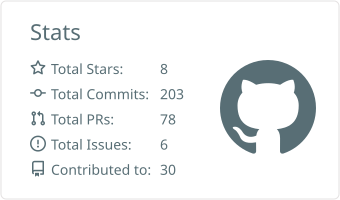
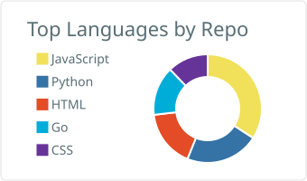
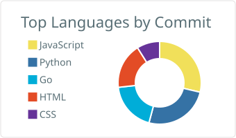
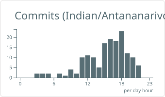

<!-- ===== HEADER ===== -->

  

<h1 align="center">Safidy Mahefa</h1>

  <strong>Développeur Full-Stack</strong>

  
  
  

---

## À propos

Je suis **Safidy Mahefa**, étudiant en **Informatique de gestion, Génie logiciel et Intelligence Artificielle** à l’**ISPM** (Madagascar).

> *Never reinvent the wheel* : comprendre les bases en profondeur avant de construire dessus.

---

## Compétences techniques

### Langages

  
  
  
  

  

### Web & Desktop

  
  
  
  

### Base de données

  

### Outils

  
  
  

### Méthodes & conception

  
  
  

---

## Statistiques GitHub

  
  

  

  
  

---

## Projet mis en avant

**Connais-tu Madagascar**
Projet orienté découverte culturelle et valorisation du pays, avec une attention particulière portée à la **structure du code**, à la **clarté** et à la **simplicité**.

---

## Objectifs

- Approfondir mes compétences en développement
- Maîtriser parfaitement les bases avant les technologies avancées
- Construire des projets utiles et bien structurés
- Développer un profil solide et professionnel

---

## Me retrouver

  
  
  
  

---

  

